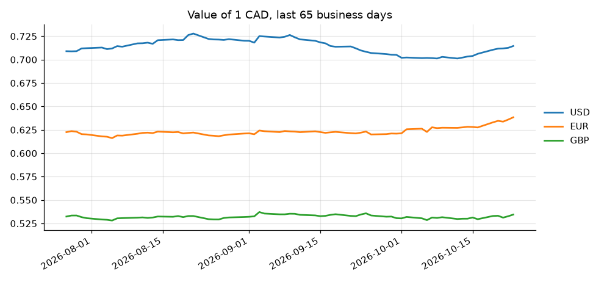

# 5. Exchange rates from an API

**The situation:** a business that buys in US dollars and euros needs the daily exchange rates in a
spreadsheet for its pricing and bookkeeping. Today, someone looks them up and types them in.

**What this does:** it pulls daily rates from a free public API (European Central Bank data, no key
needed), stores them in a small SQLite database, and exports an Excel file and a chart. On later
runs it only downloads the days it doesn't have yet.

## Run it

```bash
.venv/bin/python 05-exchange-rates/rates.py --base CAD --currencies USD EUR GBP --days 90
```

```
Downloaded 195 new rate(s)

1 CAD on 2026-10-23:
  USD  0.7145   (+0.78% since 2026-07-27)
  EUR  0.6384   (+2.55% since 2026-07-27)
  GBP  0.5345   (+0.39% since 2026-07-27)

Saved rates.xlsx and rates.png
```

Run it again the same day:

```
Downloaded 0 new rate(s)
```

## What you get

- `rates.db`: a SQLite database that keeps growing day after day.
- `rates.xlsx`: one row per business day, one column per currency, with a line chart.

| Date | 1 CAD in USD | 1 CAD in EUR | 1 CAD in GBP |
|---|---|---|---|
| 2026-07-27 | 0.7090 | 0.6225 | 0.5324 |
| 2026-07-28 | 0.7088 | 0.6236 | 0.5335 |
| 2026-07-29 | 0.7090 | 0.6230 | 0.5335 |

- `rates.png`: a chart ready to drop into an email or a report.



## Details worth knowing

- **Incremental:** it asks the database for the last day it has and only downloads what's missing.
  That makes it safe to run every morning from cron (`0 7 * * 1-5`).
- **Weekends and holidays:** the central bank doesn't publish rates on those days. The script
  doesn't store Friday's rates twice.
- **Any currency pair:** `--base` and `--currencies` take any currency the API knows.

## Adapting it

The same pipeline (API, database, report) works for weather data, stock prices, shipping rates,
Shopify orders or any service with a REST API.
