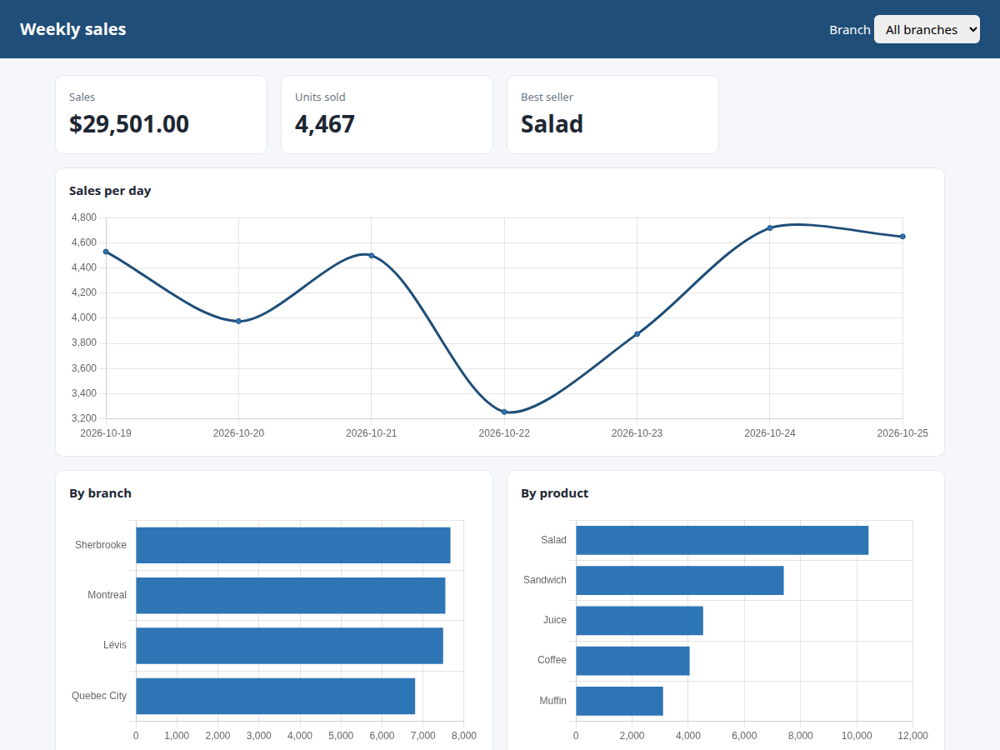

# 6. Sales dashboard in the browser

**The situation:** the owner from demo 3 now has a nice Excel report every Monday, but would rather
open a web page and see the week at a glance, filter by branch, and not dig through sheets.

**What this does:** a small Flask web app that reads the same CSV files as demo 3 and shows the key
numbers and three charts. Pick a branch in the menu and everything updates. When a new file lands
in the data folder, it shows up on the next page load.



## Run it

It uses the sample data from demo 3, so create it first if you haven't:

```bash
.venv/bin/python 03-csv-report/make_sample_data.py
.venv/bin/python 06-sales-dashboard/app.py
```

Then open http://127.0.0.1:5050.

## What's on the page

- **Four key numbers:** total sales, units sold, best-selling product, top branch.
- **Sales per day:** a line chart over the week.
- **By branch** and **By product:** bar charts, sorted from highest to lowest.
- **Branch filter:** the whole page switches to one branch.

The data also comes out as JSON, which is handy to plug into something else:

```bash
curl "http://127.0.0.1:5050/api/summary?region=Montreal"
```

```json
{"total_sales": 7541.75, "units": 1171, "orders": 35,
 "by_region": [{"name": "Montreal", "sales": 7541.75}],
 "by_product": [{"name": "Salad", "sales": 2739.0}, ...],
 "by_day": [{"day": "2026-10-19", "sales": 1202.0}, ...]}
```

## Details worth knowing

- **No copy-paste between demos:** the CSV reading comes straight from demo 3's `merge.py`, so a
  fix there helps both.
- **Lightweight:** Flask on the server, Chart.js in the browser, no database and no build step.
- **Runs locally** by default (`127.0.0.1`). Putting it online for a team means adding a login and
  a proper web server in front, which is a short job.

## Adapting it

Any data that lives in CSV, Excel, a database or an API can feed a page like this: inventory levels,
support tickets, website orders, production numbers.
