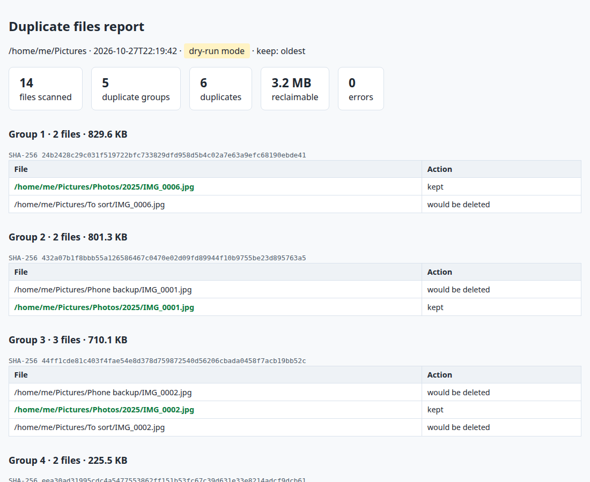

# 7. Duplicate file finder (CLI + JSON/HTML report)

**The situation:** years of phone backups, "to sort" folders and copies of copies. The disk is full and
nobody dares delete anything, because you can't tell by eye which files are really identical.

**What this does:** it scans a folder, finds files with exactly the same content, and writes a report
that shows which copy it would keep and which ones it would delete. **By default nothing is deleted**;
the clean-up only happens with `--apply`.

- **Fast:** files are grouped by size first. A file with a unique size can't have a duplicate, so it is
  never read. Only same-size files are hashed (SHA-256, in 1 MB chunks, so memory stays low on large files).
- **Safe:** dry-run by default, symlinks ignored, unreadable files or folders listed in the report
  instead of stopping the scan.
- **Tested:** 16 acceptance tests with `pytest`, one per requirement.
- **Packaged:** a real command line tool (`pyproject.toml`, installable with `uv` or `pip`), standard library only.

## Run it

```bash
cd 07-duplicate-finder
python3 make_sample_files.py                    # creates sample/ with duplicate photos and documents
uv run dupfinder sample --json report.json --html report.html
```

```
14 files scanned, 5 groups, 6 duplicates, 3.2 MB reclaimable, 0 errors.
Dry-run mode: nothing deleted (add --apply to clean up).
```

Then, once the report looks right:

```bash
uv run dupfinder sample --apply --keep oldest
```

No `uv`? `pip install .` then `dupfinder ...` works the same.

## What you get



The JSON report has the same content, ready for another script:

```json
{
  "mode": "dry-run",
  "keep_rule": "oldest",
  "summary": {"files_scanned": 14, "groups": 5, "duplicates": 6, "reclaimable_bytes": 3362177},
  "groups": [
    {"sha256": "24b2428c…", "size": 849545,
     "keep": ".../Photos/2025/IMG_0006.jpg",
     "files": [".../Photos/2025/IMG_0006.jpg", ".../To sort/IMG_0006.jpg"]}
  ],
  "deleted": [],
  "errors": []
}
```

## Options

| Option | Effect |
|---|---|
| `--dry-run` | Report only, delete nothing (default) |
| `--apply` | Delete duplicates, keep one file per group |
| `--keep oldest\|newest\|shortest` | Which copy to keep: oldest (default), newest, or shortest path |
| `--min-size BYTES` | Smallest size considered (default 1: skips empty files) |
| `--json FILE` / `--html FILE` | Write the reports |

## Tests

```bash
uv run pytest
```

```
................                                                         [100%]
16 passed in 0.15s
```

## Limits

- Compares exact content: two photos that look the same but were re-encoded are not duplicates.
- `--apply` deletes for good (no recycle bin): read the dry-run report first.
