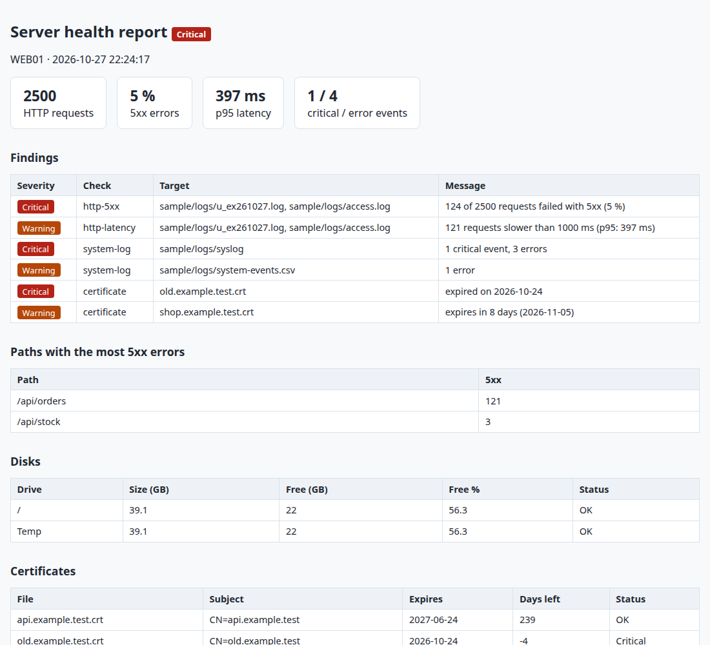

# 8. Server health audit in PowerShell (IIS, Nginx, system logs, disks, certificates)

**The situation:** a website goes down on a Friday afternoon. The clues are spread everywhere: IIS or
Nginx logs, the Windows event log or syslog, a disk filling up, a certificate that expired on Tuesday.
Someone has to open each one by hand to find out what happened.

**What this does:** one PowerShell command reads all of it and writes a single report that says what is
wrong, how bad it is, and where to look. It returns an exit code (0 OK, 1 Warning, 2 Critical), so a
scheduled task or a monitoring tool can raise an alert on its own.

| Check | What it looks for |
|---|---|
| HTTP logs | IIS W3C (`#Fields` header) or Nginx/Apache combined format, detected automatically: 5xx rate, slow requests, 95th percentile latency, the paths failing most |
| System logs | Linux syslog/journal, or Windows events exported to CSV: critical and error events by source |
| Disks | Free space on every drive, with warning and critical thresholds |
| Certificates | `.crt`, `.cer`, `.pem` files: expired or expiring within 30 days |

A missing log or folder becomes a finding in the report instead of stopping the audit.

## Run it

PowerShell 7 (`pwsh`) on Windows, Linux or macOS. Tests use [Pester](https://pester.dev).

```powershell
cd 08-server-health-audit
./New-SampleData.ps1          # one fake day of IIS + Nginx logs, a syslog, Windows events, 3 certificates
./Invoke-HealthAudit.ps1 -AccessLog sample/logs/u_ex261027.log, sample/logs/access.log `
    -SystemLog sample/logs/syslog, sample/logs/system-events.csv `
    -CertificatePath sample/certs -JsonPath report.json -HtmlPath report.html
```

```
Status: Critical
HTTP: 2500 requests, 5 % 5xx, p95 397 ms

Severity Check        Target                     Message
-------- -----        ------                     -------
Critical http-5xx     sample/logs/u_ex261027.log 124 of 2500 requests failed with 5xx (5 %)
Warning  http-latency sample/logs/u_ex261027.log 121 requests slower than 1000 ms (p95: 397 ms)
Critical system-log   sample/logs/syslog         1 critical event, 3 errors
Warning  system-log   sample/logs/system-events… 1 error
Critical certificate  old.example.test.crt       expired on 2026-10-24
Warning  certificate  shop.example.test.crt      expires in 8 days (2026-11-05)
```

On a real Windows server, for example in a scheduled task every morning:

```powershell
Get-WinEvent -LogName System -MaxEvents 2000 | Export-Csv C:\reports\system.csv -NoTypeInformation
./Invoke-HealthAudit.ps1 -AccessLog (Get-ChildItem C:\inetpub\logs\LogFiles\W3SVC1\*.log) `
    -SystemLog C:\reports\system.csv -CertificatePath C:\certs -HtmlPath C:\reports\health.html
```

## What you get



The same data is in `report.json` for a dashboard or another script.

## Thresholds

| Parameter | Default |
|---|---|
| `-ErrorRateWarn` / `-ErrorRateCritical` | 1 % / 5 % of requests with a 5xx status |
| `-SlowMs` | 1000 ms |
| `-CertWarnDays` | 30 days |
| Disk free space (`Get-DiskStatus -WarnPercent / -CriticalPercent`) | 15 % / 5 % |

## Tests

```powershell
Invoke-Pester ./tests
```

```
Tests Passed: 19, Failed: 0, Skipped: 0
```

The tests build their own logs and generate real certificates (expired, expiring, valid) on the fly,
so they run anywhere without fixtures.
