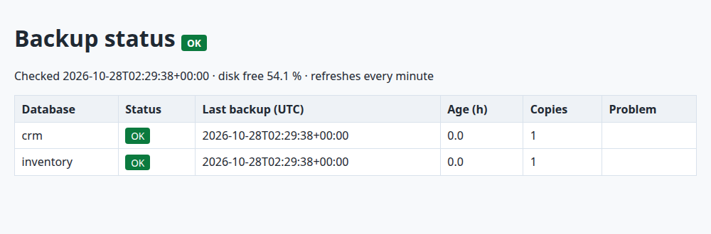

# 9. Automated database backups with Docker (Postgres + SQLite, SHA-256, rotation, status page)

**The situation:** the business runs on a Postgres database and an app that keeps its data in SQLite.
Backups are "a script someone wrote once". Nobody knows if it still runs, whether the copies can be
restored, or how much disk they eat.

**What this does:** one `docker compose up -d` starts a backup service that, on a schedule:

1. **Backs up** each database: `pg_dump` (custom format) for Postgres, SQLite's online backup API for
   SQLite, so the copy is consistent even while the app is writing.
2. **Checks** every copy: a `.sha256` file next to each backup (same format as `sha256sum`), plus
   `PRAGMA integrity_check` for SQLite and a format check for Postgres dumps.
3. **Rotates** old copies: keeps the newest backup of each of the last 7 days and of each of the last 4 weeks.
4. **Publishes a status page** on `http://127.0.0.1:8080` (and `status.json` for a monitoring tool):
   green when every database has a recent, valid backup; orange or red otherwise.

The backup role in Postgres is **read-only** (`pg_read_all_data`), passwords live in `.env` (not in Git),
backup files are `chmod 600`, and the container runs as a non-root user.

## Run it

Docker with Compose v2.

```bash
cd 09-docker-backup-monitor
cp .env.example .env              # then choose your own passwords
python3 make_sample_data.py       # creates data/inventory.db (2,000 rows) and the backups/ folder
docker compose up -d
```

```
backup-1  | OK      inventory-20261028T022938Z.sqlite (131072 bytes)
backup-1  | OK      crm-20261028T022938Z.dump (5252 bytes)
backup-1  | OK: crm OK, inventory OK
```

Open http://127.0.0.1:8080:



The copies land in `backups/` and can be checked with standard tools:

```bash
cd backups && sha256sum -c *.sha256
crm-20261028T022938Z.dump: OK
inventory-20261028T022938Z.sqlite: OK
```

## Restore (tested)

A backup is only worth something if it restores. This was run against the stack above:

```bash
docker compose exec -T db createdb -U postgres crm_restore_test
docker compose exec -T db pg_restore -U postgres -d crm_restore_test --no-owner < backups/crm-<date>.dump
docker compose exec -T db psql -U postgres -d crm_restore_test -tAc "select count(*) from customers"
500
```

For SQLite, the backup *is* a database: copy it back in place, or open it with `sqlite3`.

## The CLI on its own

`backupctl.py` uses only the Python standard library (plus `pg_dump` for Postgres), so it also works
from cron on any Linux server, without Docker:

```bash
python3 backupctl.py backup --sqlite /srv/app/app.db --postgres postgresql://backup@localhost/crm --dest /var/backups/db
python3 backupctl.py verify --dest /var/backups/db
python3 backupctl.py rotate --dest /var/backups/db --keep-daily 7 --keep-weekly 4 --dry-run
python3 backupctl.py status --dest /var/backups/db --expect crm --expect app --json status.json
```

`status` exits with 0 (OK), 1 (warning: backup too old, disk almost full) or 2 (critical: missing or
corrupt backup), which Nagios-style monitors, systemd or a cron wrapper can act on.

| Setting (`.env`) | Default |
|---|---|
| `BACKUP_INTERVAL` | 86400 s (once a day) |
| `KEEP_DAILY` / `KEEP_WEEKLY` | 7 / 4 |

## Tests

```bash
pip install pytest
python3 -m pytest tests
```

```
20 passed in 0.73s
```

They cover the SQLite backup consistency, the checksum file, a corrupted backup (a single flipped byte),
a file whose checksum matches but which is not a valid database, the rotation rules over 60 days of
backups, a failing `pg_dump` (no partial file left behind), the status levels, and one full cycle of
the Bash scheduler.
