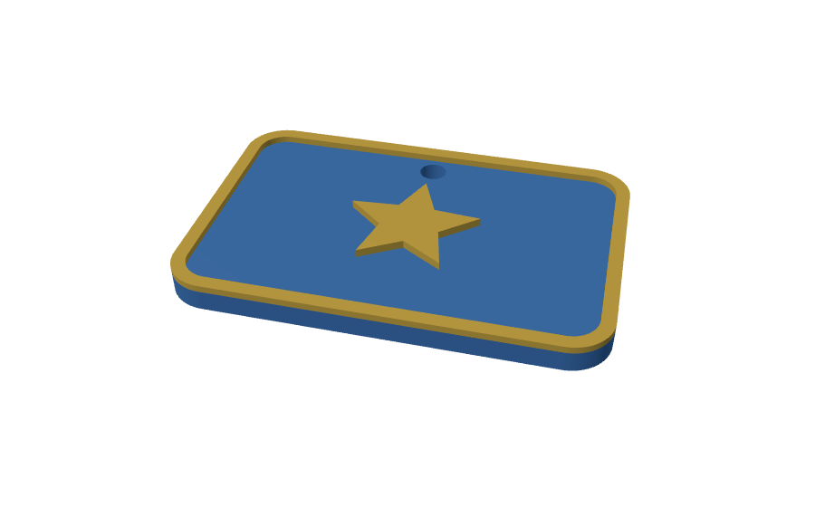
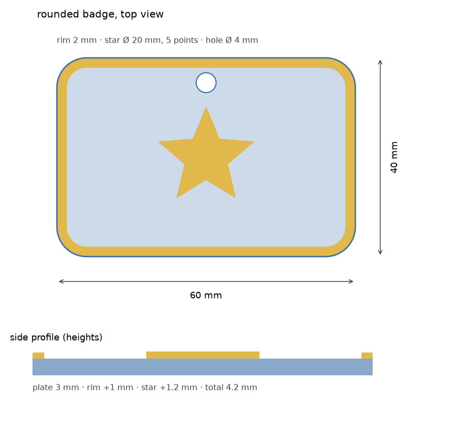

# 10. Parametric 3D-printable badges (Python → STL)

**The situation:** a club, a school or an event needs 40 badges or keyrings in four team colours, each a
slightly different size. Drawing every variant by hand in a CAD program takes an afternoon, and one
wrong dimension means a wasted print.

**What this does:** a Python script builds the 3D model from a few numbers in millimetres and writes
STL files ready for any slicer (PrusaSlicer, Cura, Bambu Studio). One command for one badge, or a CSV
file for a whole batch. Every model is **checked before it is written**: closed mesh, consistent
normals, exact dimensions.



*The STL files above, rendered in a browser with three.js.*

## Run it

```bash
pip install numpy-stl matplotlib      # matplotlib only for --preview
cd 10-parametric-stl
python badge.py -o out/badge.stl --preview out/badge.png
```

```
badge: 60.00 x 40.00 x 4.20 mm, 7.59 cm3, 8200 triangles, mesh OK
```

`--preview` draws a dimensioned plan, handy to send to a client before printing:



### Multi-colour printing

`--split` writes one STL per body (plate, rim, star). Load them together in the slicer and give each a filament:

```bash
python badge.py --shape hexagon --width 50 --height 50 --star-points 6 --star-size 26 -o out/hex.stl --split
# out/hex-plate.stl  out/hex-rim.stl  out/hex-emblem.stl
```

### A whole batch from a spreadsheet

```csv
name,shape,width,height,star_points,star_size,hole
team-blue,circle,45,,6,18,4
team-red,hexagon,50,50,6,24,0
volunteer,rounded,70,40,5,22,5
```

```bash
python badge.py --batch badges.csv --out-dir out/batch
```

```
team-blue: 45.00 x 45.00 x 4.20 mm, 5.13 cm3, 8672 triangles, mesh OK
team-red: 50.00 x 50.00 x 4.20 mm, 6.17 cm3, 4448 triangles, mesh OK
volunteer: 70.00 x 40.00 x 4.20 mm, 8.85 cm3, 8200 triangles, mesh OK
```

## Parameters (mm)

| Option | Default | |
|---|---|---|
| `--shape` | `rounded` | `rounded`, `circle` (width = diameter) or `hexagon` |
| `--width`, `--height` | 60, 40 | outer size |
| `--corner` | 6 | corner radius (rounded) |
| `--thickness` | 3 | plate |
| `--rim`, `--rim-height` | 2, 1 | raised border; `--rim 0` for none |
| `--star-points`, `--star-size`, `--star-inner` | 5, 20, 0.45 | star emblem; `--star-points 0` for none |
| `--emblem-height` | 1.2 | star relief |
| `--hole` | 4 | keyring hole diameter; `0` for none |

Impossible combinations are refused with a clear message instead of producing a broken model:

```
$ python badge.py --star-size 90
badge: the star (90.0 mm) does not fit inside the rim
```

## How it works

Each body is an extrusion of a 2D outline. Outlines are sampled along rays from a centre point, so the
plate with its keyring hole is a single ring of quads between two loops (no general triangulation
library needed) and every polygon corner is kept exactly. The mesh is plain NumPy; `numpy-stl` only
writes the binary STL.

## Tests

```bash
pip install pytest numpy-stl matplotlib
python -m pytest tests
```

```
21 passed in 1.63s
```

The geometry is validated, not just "the file exists":

- every edge of every body is shared by exactly two triangles, in opposite directions (closed and
  consistently oriented), and no triangle has zero area;
- the volume computed from the mesh matches the formula: rounded rectangle `(w·h − (4 − π)·r²)·t`,
  star `n·R·r·sin(π/n)·h`, keyring hole `π·r²·t`;
- outer dimensions are within 0.01 mm of the request, reliefs stay inside the plate;
- the checker itself is tested: it catches a missing triangle and a flipped one.
